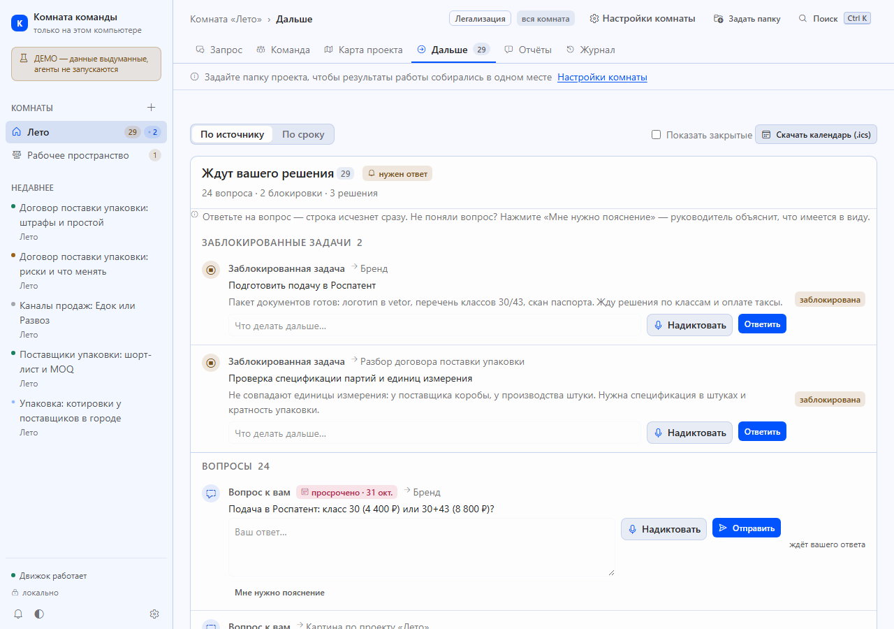
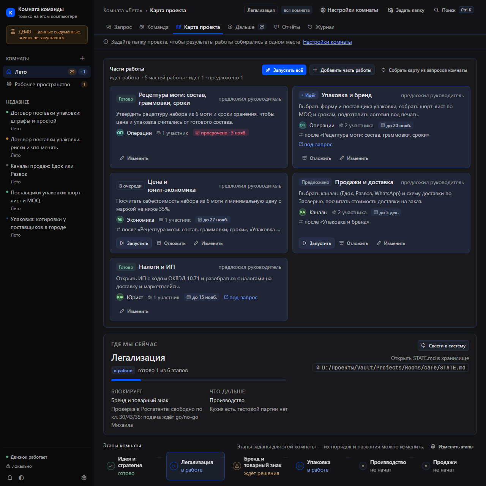
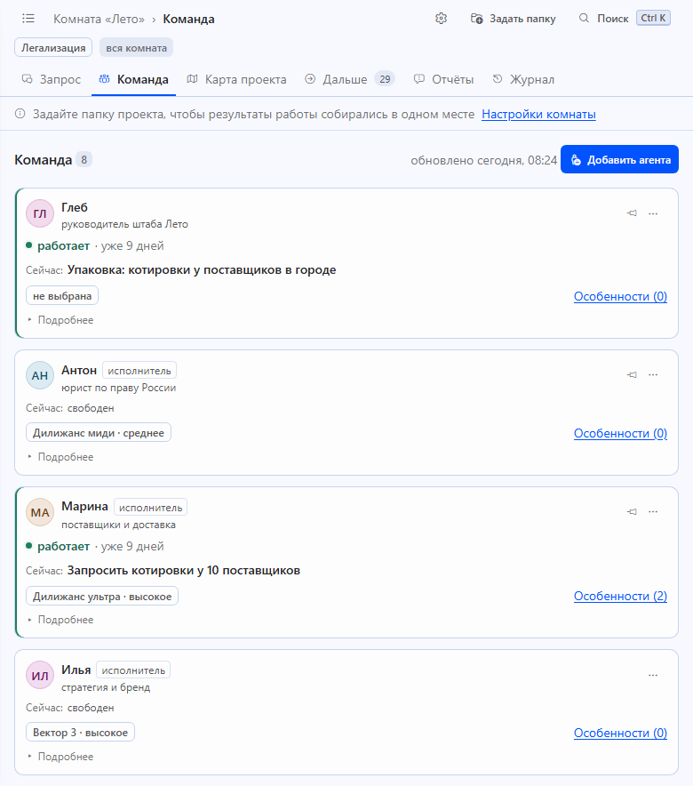
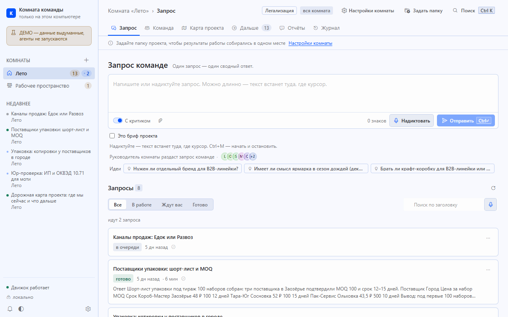
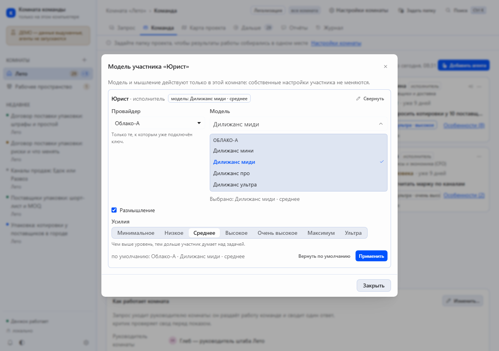

# Комната команды (Team Room) 1.0.1

[](https://github.com/vorchun18-svg/team-room-for-hermes/actions/workflows/ci.yml)

Локальная «комната команды» для небольшой команды людей и ИИ-агентов: комнаты,
запросы, дорожная карта, бэклог, отчёты с графиками и журнал. Работает на вашем
компьютере, без облака, без внешних библиотек и без сборки.

* Сервер — Python 3.11+ (только стандартная библиотека).
* Интерфейс — обычные ES-модули и CSS, открывается в браузере или внутри Hermes Desktop.
* Данные — папка `data/` рядом с программой; в репозиторий она не попадает.

## Требования

Обязательно: Windows 10/11 и Python 3.11+. Hermes Desktop — хост приложения
(без него страница открывается в браузере, меню и сторож не работают).

Необязательно — приложение работает и без этого, разница видна в `/api/health`
(блок `features`) и `/api/stt/status`:

| Что | Если есть | Если нет |
|---|---|---|
| `hermes` CLI | запись карточек в канбан | режим просмотра: чтение работает, запись объясняется плашкой |
| `faster-whisper` **или** STT-провайдер, настроенный в Hermes | диктовка в любом поле | текст печатается руками, микрофон сообщает «диктовка недоступна» |
| хранилище Obsidian (Vault) | зеркало комнат в заметках | работаем без зеркала, подсказываем `TEAMROOM_VAULT_DIR` |

## Что умеет

* **Комнаты.** У каждой комнаты — название, иконка, руководитель, критик и состав
  участников, проверка ответа критиком и число раундов, доска задач, папка проекта,
  проектный режим, запуск направлений (сразу или сначала план) и сколько направлений
  идёт одновременно (1–4). Всё это в одном диалоге настроек.
* **Модели участников.** Любому участнику — руководителю, критику, исполнителю — можно
  выбрать провайдера, модель и уровень мышления. Замена действует только в этой комнате:
  файлы профиля (`config.yaml`, `SOUL.md`, навыки) не меняются, по умолчанию участник
  работает на своей обычной модели. Новые карточки уходят на выбранную модель сами,
  для идущих есть кнопка «Перезапустить на новой модели».
* **Особые указания участнику.** Добавка к роли, действующая только в этой комнате:
  правила, на что смотреть, как делать иначе. Файлы профилей не меняются.
* **Папка проекта.** Одно место для результатов у каждой комнаты: подпапка на каждый
  запрос, автосодержание `README.md`, кнопка «Открыть папку проекта». Путь проверяется
  до сохранения — системные и служебные каталоги не принимаются.
* **Проектный режим.** Главный запрос (бриф) → руководитель предлагает карту из 3–8
  направлений → «Запустить» → направления идут по очереди, соблюдая зависимости.
* **Диалог по запросу.** Уточнение уходит руководителю комнаты, он передаёт нужным
  участникам и отвечает в ленте.
* **Дальше, отчёты, журнал.** Шаги с владельцем и сроком, вопросы к вам, решения;
  интерактивные отчёты (таблицы, графики, связи) с выгрузкой в один HTML-файл.
* **Диктовка.** Микрофон у каждого поля, словарь терминов и автозамены; аудио не покидает
  компьютер.

## Установка одной командой

Windows, PowerShell (Hermes Desktop уже установлен):

```
powershell -NoProfile -ExecutionPolicy Bypass -Command "irm https://raw.githubusercontent.com/vorchun18-svg/team-room-for-hermes/main/install.ps1 | iex"
```

Одна строка скачивает релиз, ставит приложение и модуль «Командные комнаты» в Hermes
Desktop, поднимает сервер и открывает страницу. Повторный запуск безопасен; удаление —
`install.ps1 -Uninstall`. Подробности, параметры и требования — [docs/INSTALL.md](docs/INSTALL.md).

Приложение ставится в `%LOCALAPPDATA%\TeamRoom` (данные — там же, в `data/`).
Ничего не нужно настраивать: пути, Hermes и Obsidian определяются сами. Если Vault не
найден — приложение работает без зеркала и пишет подсказку `TEAMROOM_VAULT_DIR`;
если не установлен `faster-whisper` — диктовка сообщает об этом, остальное работает.

## Быстрый старт (демо на выдуманных данных)

```
start-demo-room.cmd            # Windows, порт 8778
python tools/mock_server.py --port 8778
```

Откройте <http://127.0.0.1:8778>. Демо ничего не пишет в настоящие доски и Vault.

## Боевой режим

```
python server/app.py --port 8777      # http://127.0.0.1:8777
python tools/team_room_guard.py --dry-run
python tools/install_desktop_plugin.py --help
```

Все пути настраиваются переменными окружения (см. `server/config.py`):
`TEAMROOM_HOME` (по умолчанию `%USERPROFILE%\TeamRoom`), `TEAMROOM_DATA`,
`TEAMROOM_VAULT_DIR`, `TEAMROOM_PORT`, `TEAMROOM_HERMES_HOME`,
`TEAMROOM_HERMES_CLI`, `TEAMROOM_EXTRA_ROOTS`.

## Документация

| Файл | О чём |
|---|---|
| `docs/USER-GUIDE.md` | как пользоваться, простыми словами |
| `docs/DEMO.md` | демо-стенд на выдуманных данных |
| `docs/AGENT-GUIDE.md` | как в комнате работают ИИ-агенты |
| `docs/API.md` | HTTP API |
| `docs/ARCHITECTURE.md` | устройство сервера и интерфейса |
| `docs/DESIGN-NOTES.md` | решения по интерфейсу |
| `docs/INSTALL.md` | установка одной командой, параметры, удаление |
| `docs/SAFETY-RULES.md` | правила безопасности и песочница |
| `docs/DESKTOP-MODULE.md` | модуль внутри Hermes Desktop |
| `docs/INTEGRATION-HERMES.md` | связка с Hermes (канбан, профили) |
| `reportkit/SPEC.md` | формат отчётов |

## Скриншоты

Демо-стенд на выдуманных данных: кофейня-кондитерская «Лето» в Заозёрье.

| | |
|---|---|
|  |  |
|  |  |
|  | Диалог комнаты: провайдер, модель и уровень мышления участника — только для этой комнаты. |

## Тесты

```
python -m unittest discover -s tests -p "test_*.py"
node --test tests/
python tools/portability_check.py          # две песочницы: «чистая машина» и копия живой структуры
```

## Лицензия

MIT — см. `LICENSE`. Автор — vorchun.
